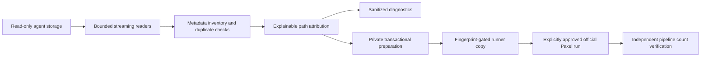

# Architecture

`discovery/codex.py` walks roots without following storage symlinks, validates JSONL
one bounded line at a time, hashes the decompressed stream, and reads only metadata
fields into memory. `discovery/antigravity.py` recognizes three surface layouts,
reads binary SQLite metadata, and falls back to structured transcript cwd fields.
Transcripts themselves never enter domain models.

`models.py` defines sessions and decisions. `attribution.py` canonicalizes paths
and compares components, including historical missing tails. It annotates existing
Git markers and worktree `.git` files without invoking Git in untrusted directories.
It never infers a child's remote for parent-workspace activity. Multiple cwd evidence
must all lie in scope; crossing boundaries is ambiguous and excluded.

`diagnostics.py` deduplicates by agent/recorded ID, or content hash without an ID.
Identical bytes plus identical attribution evidence permit one canonical copy.
Conflicting copies with the same ID are all excluded. Plaintext is preferred when
identical compressed/uncompressed copies coexist. Root overlaps therefore do not
multiply eligible sessions. JSON schema version 1 is documented separately.

`preparation.py` writes a private sibling staging directory and renames it only
once every included stream matches its inventoried hash. IDs/paths never become
filesystem names: stable hashes generate names. Codex bytes are preserved exactly;
Antigravity gains a synthetic metadata header followed by the unchanged body.
Sidecars carry actual recorded cwd/remotes for Paxel grouping, never invented ones.
Multiple-repository evidence stays represented in the manifest; a sidecar uses one
recorded cwd as a grouping hint, not proof that all work belongs to one repository.

`integration/detection.py` checks full installer SHA-256. `patching.py` adds an explicit
prepared-only scope branch and narrowly overrides collectors in the generated copy.
The existing read-only transcript Docker mount consumes prepared agent-prefixed
buckets and `_metadata.json`. This avoids remote filtering and host discovery while
retaining the normal downstream normalizers, project discoverer, parser, scoring,
report and upload behavior. Those downstream components are external, mutable,
and not certified by this repository. Readable diffs and Bash syntax checks expose
the exact adaptation. Unknown runners cannot be patched.

`integration/verification.py` hashes prepared files, checks exact file and bucket
sets, and extracts named stage counts from one log. Repeated observations are
ambiguous. Individual identities and server upload cannot be established from
aggregate logs. No report scoring engine is duplicated.

`cli.py` and `SKILL.md` share the same Python implementation. There is no hosted
service, telemetry, generic plugin framework or implicit external execution.
